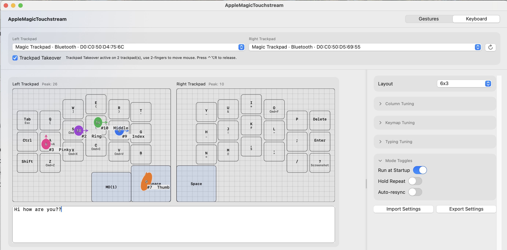
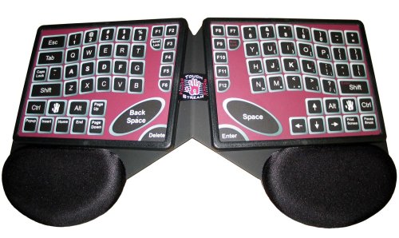
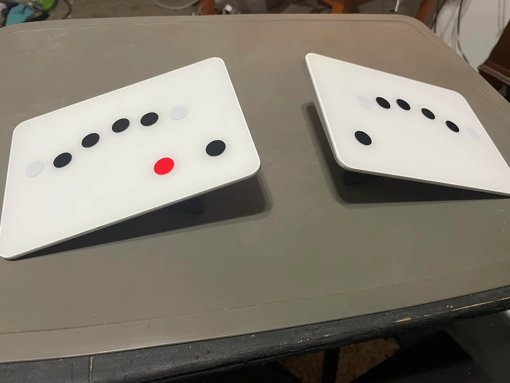
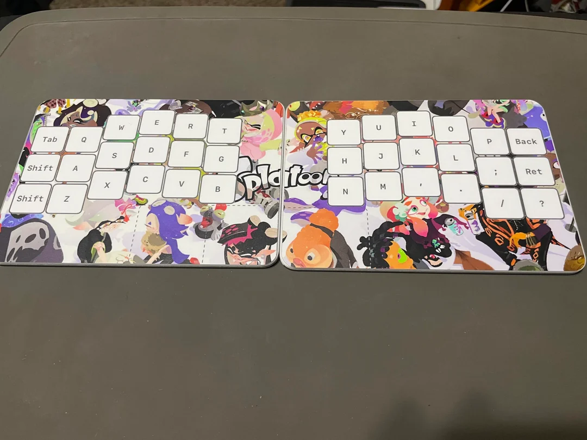

## Apple Magic TouchstreamLP

## Usage
### I have posted installers under <a href="https://github.com/disarmyouwitha/AppleMagicTouchstreamLP/releases/">Releases</a>!

**Useful Tips:**
- **TURN ON** "Trackpad Takeover" / "Mouse Takeover": 
This app was written with specific preferences in mind (1-finger = typing, 2-finger mouse + Gestures) this option takes full control of the mouse from the OS to enforce this. You can set Gestures such as Scroll, Zoom, etc in the Gestures menu to replace your OS-level gestures.

**You can use just 1 Trackpad!**
- I encourage you to try it out with your normal split keyboard setup + Apple Magic Trackpad first before you commit to two!
- There is also a "Blank" mode where you can just use it as a Trackpad + Gestures + Custom buttons

## Mac: **(Packaged with signed .DMG)**
- Built on top of the wonderful: https://github.com/Kyome22/OpenMultitouchSupport

*The app will ask for elevated permissions on first run*

## Windows: **(*PREREQUISITE INSTALL)**
- Supports both the Official Apple Bootcamp drivers and Opensource drivers!
- **Please follow the <a href="windows_linux/GlassToKey.Windows/INSTALL.md" target="_NEW">DRIVER INSTALL GUIDE</a>!**

****If you can move your mouse and you can scroll with a 2-finger gesture — you already have drivers installed!***

## Linux:
- Thanks to the Linux community, support for this device is already included in the mainline Linux kernel.

## Intention

The Fingerworks TouchStreamLP was a flat, zero-force, gesture keyboard developed for people with RSI in 2002 — it was way before it’s time, and it was *totally rad* FingerWorks was acquired by Apple in 2005 and the TouchStreamLP was immediately discontinued, the technology becoming the basis for the iPhone’s touchscreen in 2007.

**——So here we are——:** it has come full circle. ⭕️

I have been working to revive this ancient keyboard using the DNA of it’s own lineage — the Apple Magic Trackpad!

Since it is built on the same technology, I thought it would be fun to try and create an open source version~

**Special thank you to @FRANF23 and @InternOne1306 for being my very early adopters and helping me test!!**

**Special thank you to @karacodes for the inspiration and motivation to revisit this project!**
