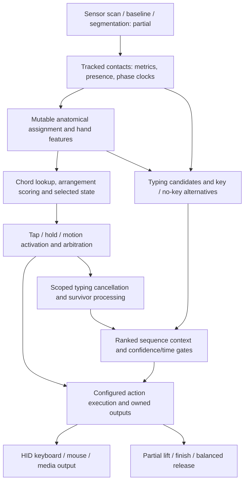

# FingerWorks recognition findings

Reverse-engineering implementation reference · **2026-10-25**.

This document is the source of truth for what our reverse engineering establishes about TouchStream recognition, chording, typing arbitration, mouse behavior and output ownership. Use it when deciding how to implement a FingerWorks gesture in AppleMagicTouchstream. [GESTURE_ENGINE.md](AppleMagicTouchstream/GESTURE_ENGINE.md) remains the contract for what the application currently does, including its deliberately provisional thresholds. A difference between the two is an implementation/fidelity question to resolve explicitly, not permission to silently change accepted behavior.

This is a connected reconstruction from shipped firmware, its configuration utility, packaged defaults, SDK code, saved Ghidra projects, bounded emulator checks and contact recordings. It is **not recovered original C**, complete firmware emulation, or a claim that Apple exposes the same sensor model. An apparently working gesture does not prove its entire proprietary recognizer was recovered.

**Current implementation handoff:** start with [five-finger latching](#five-finger-latching-implementation-handoff) for the next task, then [typing/gesture arbitration](#arbitration-implementation-handoff). These sections identify implementation requirements, useful regression cases and the limits of the firmware evidence. The maintained app's `AGENTS.md` and `GESTURE_ENGINE.md` govern accepted behavior; research exceptions do not silently override those contracts.

## 1. How to use this reference

For a new gesture, follow the chain in order:

1. Locate its original configuration definition and active categories/context. Distinguish the guide's pictured/recommended fingers from a hard recognition predicate.
2. Decode anatomical pattern, any-permutation/fallback behavior, arrangement/region constraints and configured actions.
3. Identify the entry/activation gates and the evidence they consume: position, shape, signal phase, membership history or elapsed time.
4. Define selected, activated and action-owning state separately. Check ordinary, special and combined-hand routes rather than generalizing one branch.
5. Trace tap, hold, slide, partial lift, finish and cancellation through actual output/release ownership.
6. Declare which Apple inputs can supply equivalent evidence and which measurements need calibration or a new proxy.
7. Record exact deviations and unknowns in the gesture specification, then test positive, competing, cancellation and ownership cases offline before hardware acceptance.

Nominal firmware milliseconds and centimeter positions now have original SDK/report bindings (section22). Preserve that protocol evidence separately from physical accuracy and Apple calibration; a plausible number alone is insufficient. Do not copy a compact helper's predicate while omitting its caller's eligibility gates or cleanup effects.

### Evidence levels

| Label used here | What it establishes |
| --- | --- |
| Original configuration / utility | What the shipped definitions declare or serialize; not proof of the configuration running on a particular keyboard. |
| Static firmware flow | Original-word control/data flow corroborated by independent GNU decode and retained REA/Ghidra records. It does not observe execution. |
| Bounded execution | Original instructions execute on synthetic state inside an explicitly stated helper/slice. No automatic whole-system or physical validation. |
| Ideal arithmetic | A mathematical interpretation of DSP FP code/constants. Exact FP rounding and all path behavior can remain unexecuted. |
| Capture observation | What a specific recorded input stream contains, with input identity and analysis scope. Not automatic gesture intent or output-delivery truth. |
| Implementation proposal | An engineering choice for AppleMagicTouchstream, explicitly separate from recovered firmware behavior. |

### Target identity and address rules

The original `touchstream.U.byt` reports firmware version `0x0160`. Its SHA-256 is `87262a818209a1e019990f1e40f1b55d9d2dd030644d0f5aa0ed7e8cf09476e1`. The vendor container has 5,269 checked records; the decoded payload is158,004 bytes with vendor CRC32 `0x70B9ACF7`. The CPU is C3x-family; the exact chip is unconfirmed.

All firmware addresses below are **DSP word addresses, four bytes per word**. REA's bridge byte-offset coordinate can be four times the DSP address. Direct `@offset` interpretations assume startup DP=`0x80`. Word offsets in recovered records are neither Swift field offsets nor Apple callback offsets. The experimental processor has selected integer semantics; unsupported FP, repeat, parallel and other forms remain explicit limitations.

## 2. The recovered system is a pipeline of distinct representations



A tracked path, anatomical finger, hand affiliation, typing candidate, selected chord, activated chord, saved interpretation and emitted output are different objects. A label can change without a new contact. A selected chord can exist before activation. A candidate can be processed without an event being posted. A gesture can invalidate typing evidence without retracting text already delivered.

**Implementation consequence:** use an explicit coordinator and ownership ledger, not a single mutable `currentGesture` or `currentKey` inferred from instantaneous finger count. Preserve contact generations independently of anatomical assignment and semantic ownership.

## 3. Apple contacts: the usable input contract and its limits

Our macOS callback supplies parsed contact frames. It does not supply TouchStream-style typing/gesture decisions, nor raw electrode-grid measurements. Upstream Apple processing still parses, rescales and manages contact state; this research does not locate every Apple estimation/classification step.

| Available field | Useful evidence | Important limitation |
| --- | --- | --- |
| Native device identity | Per-pad routing and independent sessions | Bridge deviceIndex slots can be reused; do not treat them as permanent physical pads or anatomical hands. |
| Contact identifier | Frame association | Use `(device, ID, generation)`; reused ID must not inherit old ownership. |
| Source frame/time and capture arrival clock | Within-device motion and timing; delivery quality | Keep clocks distinct; do not subtract unsynchronized source clocks across pads. |
| Normalized and absolute position | Geometry and trajectory | Native binary conversion divides coordinates by100, but the name “absolute” alone does not prove physical millimetres. |
| Normalized and absolute velocity | Motion estimation/checks | Compare against finite differences and timestamps; retain provenance, gap resets and quantization. |
| Major/minor axes and orientation | Contact ellipse/aspect/orientation | Verify axis order, angle convention, periodicity and near-circular ambiguity. |
| `total`, `pressure`, `density` | Separate signal/shape candidates | Not interchangeable and not established physical force/capacitance units or firmware-strength equivalents. |
| `fingerID`, `handID` | Soft classification/context evidence | Can revise within one lifetime; handID can remain1 while finger labels change. Do not equate constant1 with known anatomical right/left. |
| Lifecycle state | Parsed state evidence | The framework can repair continuity based on prior state/time. Enum values are not firmware acquisition/departure events. |

The local C bridge's96-byte MTTouch layout was compiled/verified against native field writes. In the inspected Compact V7 decoder, the three-bit wire finger value7 is converted to callback value12. All512 selected unpacker cases passed ID/state/finger/extra-bit checks; axis/pressure conversions executed but were not independently asserted. The mapping explains a possible source of12, not its full semantic category or proof of the report format used by every recording.

Our recordings show anatomical labels revising when neighboring fingers join or leave, and stable IDs with incorrect intended-finger labels. A constant label is not a confidence score. Finger colors should show the current estimate; recognition must separately decide whether and when semantic roles become owned.

### Scalar preservation contract

New processed records preserve `total` separately from `pressure`. Older records
recover total from a unique matching raw contact ID; an explicit processed value
takes precedence. Pressure fallback is not independent strength evidence. An audit
of 7,038 frames / 17,602 raw samples found the two scalars differed in 17,519 samples.
Original captures remain unchanged.

Detailed source: [AMT data contract](/Users/nap/Documents/new_code/touchstream-archive/driver-analysis/mac-native-15.7.4-24G517/data-contract-2026-10-17/FINDINGS.md). Calibration and controlled-trial plan: [Apple calibration experiments](RESEARCH_ARCHIVE.md#apple-native-field-calibration-experiments).

## 4. Contact metrics and phase clocks expected by TouchStream

The tracked-contact record is89 DSP words. Recovered fields on the traced paths include:

| Offset | Recovered role / producer |
| --- | --- |
| 0/1 | Tracked coordinate pair; complete coordinate convention remains qualified. |
| 2 | Integrated positive scan-minus-baseline residual strength, from precursor22 at80127F/801305. Not calibrated Apple pressure. |
| 3 | Moment-derived orientation-like value, with extent correction/wrapping. |
| 4 | Aspect-like `sqrt(lambdaMin/lambdaMax)` on the valid-strength path; low-strength defaults exist. |
| 5/6 | Filtered coordinate velocity. |
| 7 | Strength-change rate: current2 minus historical12 divided by effective scan interval62B3. |
| 8 / 18 | Speed magnitude `sqrt(vx²+vy²)` / prior update's speed via history copying. |
| 20 | Strength envelope/peak: update when current2 exceeds roughly1.1×old20; initialized0. |
| 21 / 22 | Missing-association count / contact-update count. Neither is anatomical identity or elapsed milliseconds. |
| 60 | Acquisition/threshold epoch anchor. |
| 61 | Threshold/release-like phase anchor; can be written while present. |
| 62 | Later signal-phase latch, also supplied by a first-missing fallback. |
| 68/69,70/71 | Phase-associated coordinate snapshots on traced paths. |
| 76 | Current association/presence link. |
| 77 / 78 / 79 | Mutable anatomical slot / hand affiliation / typing-candidate association. |
| 82–87 | Cached assignment factors combining signal, shape, motion and context. |

`800D31 → 800DBE/800E22 → 801261` connects scan strength, central moments, orientation/aspect and motion to tracked features. Full grid segmentation, association cost, merge/split and physical units remain incomplete. Apple contacts allow us to start downstream of electrode processing, but do not remove the need to replace/calibrate its strength evidence.

### Phase is not simply physical down/up

`C033CE` can set61 and62 while a contact is still associated. The62 arm is suppressed when62≥current60. A later60 greater than old62 can reopen the latch without clearing62; strength oscillation alone does not repeat it under unchanged60. A full contact reset zeros all89 words, while ordinary acquisition and feature initialization overwrite narrower sets.

The present-contact62 path can fire for low strength, or an early-decline condition involving age, absolute strength, envelope and negative strength-change rate. Boot thresholds include approximately0.25,0.7,0.65×peak,−0.012 and age<120; these are **static firmware-unit interpretations**, not Apple defaults. Scan interval62B3 comes from scan-clock differences with a smoothed fallback for very small deltas.

On missing association, `8013DF` increments21; first missing can record phase/position, and second missing calls retirement80139D. Retirement updates assigned-contact departure history. This is a firmware path independently traced; it must not be inferred from or conflated with the SDK's host-side two-absent-frame buffering.

**AppleMagicTouchstream implication:** maintain contact lifecycle, acquisition episode, signal-phase evidence and gesture ownership separately. A signal-phase flag does not permanently kill a contact ID. The reachability of multiple firmware epochs within one uninterrupted physical Apple lifetime remains unresolved.

## 5. Anatomical assignment is contextual and mutable

The firmware uses a coupled assignment process, not an immutable label chosen at first touch.

- `80243A` constructs contact-to-slot costs from translated templates, squared distance plus a constant, and cached contact factors.
- `809E9E` searches for the greatest strictly improving pair swap; `809EC3` evaluates a supplied pair. Equal-cost swaps do not move on those paths.
- `8025EF` scores current and±1 cyclic shifts of seven slots, with an ordering/separation penalty. `C03AC7` applies a chosen shift.
- `809E17` writes destination anatomical identities into surviving contacts77. A changed assignment does not recreate the physical contact.
- `802630` gates broader optimization and includes separate thumb/context refinement. Full optimization every frame and a globally optimal solver are not established.

Some useful ideal factor interpretations:

```text
q = 0.25*strength2 + 0.75*envelope20
factor87 = 1                    if q < 1
           1/q                  if 1 <= q <= 3
           1/(9-2*q)            if 3 < q <= 4
           q-3                  if q > 4

t ≈ abs(sin(orientation3)) * tanh(3*(orientation3-pi/2))
factor82 = 1-t
factor84 = 1+t
```

Other factors use aspect, current/previous speed, neighboring spacing/bearing and hand geometry. These FP paths are static interpretations; exact approximations/rounding, units, adaptive templates and convergence are unresolved. The complementary orientation bias does not by itself prove a standalone handedness detector.

**Implementation lesson:** keep device side, estimated anatomical hand and finger identity distinct. Preserve mutable soft evidence until the relevant recognition/ownership policy commits. Do not hardcode Apple handID=1 as a physical hand or assume a pad-side label reproduces all firmware geometry.

## 6. Chord encoding, exact lookup and count fallback

The utility explicitly serializes internal bits:

| Meaning | Internal bit |
| --- | --- |
| Spread marker |0x01 |
| Thumb |0x02 |
| Index |0x04 |
| Middle |0x08 |
| Ring |0x10 |
| Pinky |0x20 |
| Any-permutation definition |0x100000 |

Special grip bits have separate routes. Internal headers also contain count/other metadata. These are not the exported SDK chord words: utility and firmware independently shift ordinary bits and move spread/any-permutation flags when formatting hand reports. Searching firmware for exported constants can therefore miss the recognition representation.

`8021AA` searches eligible exact-pattern lists first. If none qualifies, it falls back by nonthumb count and thumb presence:

```text
index = (ordinaryMask >> 1) & 31
try eligible exact-pattern list
if none:
    n = popcount(ordinaryMask & 0x3C)
    slot = 32 if n == 0 else 31+n
    if n > 0 and thumb present: slot += 4
    use eligible fallback list
```

This omits special grips and additional eligibility deliberately. Exact-pattern precedence can matter even when a generic count definition exists.

`8021E1` selects among eligible arrangements. `C03933` checks optional regions; `C0395D` compares finger coordinates to configured templates scaled by hand-size setting62C7 and sums squared residuals. Lowest eligible geometric score wins. `80224A` prepares coordinates. This is not just contact count or an arbitrary fixed distance between fingers. Full DSP FP/repeat execution and every coordinate convention are not validated.

**Implementation lesson:** separate anatomy pattern lookup from arrangement scoring and action availability. Treat `best_fingers` as a preferred configuration pattern in context, not automatically an exact-only whitelist. Competing compact, spread and special templates require explicit arbitration.

## 7. Right-click: guide, defaults and firmware explain different layers

The quick guide page1 recommends **thumb+middle+ring**. The shipped1.60 right-hand configuration defines `T2F` with `Search & Right Click/Drag` and `T2F Spread`.

| Arrangement | Preferred `best_fingers` | Original template points |
| --- | --- | --- |
| T2F Compact |TIM |(-2,-2.9), (0,1.3), (2,1.6) |
| T2F Spread |STRP |(-6,-4.5), (2,2.5), (4,2) |
| TIP Spread |STIP |(-5,-4), (-2,2), (7,2) |

The utility mapsS to spread, andT/R/P to thumb/ring/pinky. T2F retains the any-permutation flag when preferred anatomical bits are added. **The recovered definition therefore is not an exact-only TMR rule.** TRP is the spread arrangement's preferred set, while other thumb+two-fingertip observations may reach fallback/geometry selection. That does not prove every such arrangement right-clicks: active categories, competing templates, region and lifecycle gates still apply.

The compact T2F middle-click template is enabled under `three_buttons emacs_op`; TIP Spread is a distinct XWinder candidate. Later guide pages distinguish spread right-click/drag in Linux/three-button contexts. A guide recommendation is not proof of a particular runtime profile or a hard anatomical predicate.

The right-click template supplies:

| Trigger | Configured action |
| --- | --- |
| SyncTap |Secondary Click Event: Button2 click, duration30 |
| Timedown |Secondary press |
| XY Slide |Secondary drag, with configured locking/momentum attributes |
| LiftSlide |Secondary release |

Duration30 belongs to click-action configuration, not contact dwell or Apple milliseconds. The shared tap/hold/motion family is broader than the discrete right-click currently implemented in AppleMagicTouchstream.

**Current approximation, not recovered coefficients:** AppleMagicTouchstream accepts a known thumb plus two known fingertips, with a closer fingertip pair and separated thumb; it tolerates fingertip relabeling on the same tracked pair. Its2..40mm pair separation,15mm minimum thumb separation and1.5 ratio use the app's existing160×114.9 conversion. Those limits are provisional. The full competing-template scorer, compact middle-click, TIP/XWinder and held secondary drag are not implemented by that change.

Original XML members/hashes and the historical research pointer remain [in the archive](/Users/nap/Documents/new_code/touchstream-archive/firmware-analysis/rea-investigation/right-click-2026-10-21/). Capture-backed recognition analysis is preserved in [the research archive](RESEARCH_ARCHIVE.md).

## 8. Per-hand counts and clocks are not interchangeable

`80229B` rebuilds hand state after assignment:

| Hand offset | Recovered distinction |
| --- | --- |
|14 |Raw affiliated contacts |
|17/18 |Current/previous occupied ordinary anatomical slots1..5 |
|20 |Peak ordinary count; cleared when current17 becomes0 |
|24 |Occupied ordinary slots excluding thumb |
|19/35 |Count/mask qualifying against acquisition epoch hand4 |
|34/37 |Current/previous ordinary occupied-slot mask |
|3/4/5 |Initial acquisition, mutable epoch anchor and later acquisition timing roles; inspect caller-specific differences |
|8 |Recent all-five-ordinary-slots time |
|10 |Conditional departure-cluster anchor |
|11 |Latest ordinary assigned-contact departure on traced retirement path |
|13 |Qualifying typing-event timestamp |

A raw palm can remain while the ordinary-finger episode ends. Conversely an assigned count can differ from raw contacts or epoch-qualified members. A generic “all-up” rule must specify which population it observes.

### Membership/rearm gateC03E11

This gate has multiple count/history/time arms. Its middle arm uses current ordinary count<4, a permitted pattern, five-finger history and a departure burst. The boot mask80771D=`0xD101D1DF` admits **exactly contiguous anatomical finger intervals plus empty**, checked for all32 entries. Index–middle is admitted; index–ring is excluded. Empty table membership alone does not authorize an empty gesture.

Requested count is selected chord definition6, not automatically current hand17. The arm requires `hand11-hand8 < (5-requestedCount)*62D7`, then a strict wait `now-hand11 > 1.5*62D0`. Boot62D7=36 and62D0=90 imply an ideal135nominal-firmware-ms quiet wait, supported by the later clock/SDK binding. This is neither an Apple default nor a universal gesture delay. Its integer admission prefix passes2304 synthetic cases; the FP wait/full rearm remains unexecuted. First/third integer-arm checks have separate174-case evidence.

**Implementation lesson:** partial lift, old survivors, new arrivals and palms require explicit membership/epoch history. Do not infer a smaller fresh gesture merely because the instantaneous count decreases.

## 9. Selection, activation, continuation and finish

Selector0 is selected chord; selector2 is active chord; selector9 tracks activation, with additional lock/state fields. Their meanings were refined during research: the old label suggesting9 meant sliding was incomplete because a stationary hold can activate it.

### Ordinary selection and special exceptions

`802C07` blocks ordinary replacement when an existing selection is activated. Before activation, another eligible definition with equal/greater count may replace it subject to classification bits. Special handlerC01EF9 has a separate finish/reselect path without that identical guard. The five-finger-peak path802C19 can finish and move the epoch anchor without raw all-up. These exceptions prevent a universal claim that the entire firmware locks one gesture until every raw contact lifts.

For the currently implemented mouse/scroll interaction, the user's direct TouchStream comparison supports activation at the required count followed by continued ownership across additions/partial lifts until all-up. Keep that observed behavior without extending it to untested gesture families or overwriting special firmware rules.

### Stationary hold versus moving activation

`C03B53` Timedown requires valid hand/chord, no relevant global/selection lock, a nonnull hold list and matching trigger mask, assigned count equal to peak, bounded landing spread, and enough elapsed time. Duration is definition13 low16 when nonzero, otherwise debounce+tap timeout. `8029E6` checks this separately from motion.

Moving activationC03C2E uses BeginSlide. Both reachC03BED, which installs active action/type; first activationC03BC2 sets activation, timestamps it, calls scoped typing cancellation and executes eligible configured actions. Reaching the right contact count is not itself proof of activation or emitted output.

### Quick tap

`C01D57` quick-tap path checks activation/lock state, configured timeout, eligibility and context before traversing actions. A previously activated held/moving chord does not simply receive another quick tap at release. Current app500ms/80ms/20ms/1mm limits are app policy, not a recovered complete SyncTap timing contract.

### Finish, partial lift and auxiliary cleanup

`C01D1E` reads Lift list15 from the **active** chord. Full finish can execute the available list; partial mode restricts eligible kinds. Partial lift is not universally release-everything. `C01D3F` records finish time, retains selected pointers for history, conditionally invokes Lift and clears selected/activation fields; not every selector field resets there. `C01DB7` also handles auxiliary action and directional cleanupC0162E.

**Implementation contract to derive per gesture:** separate acquisition, positive activation, continuation and release obligation. A tap proposal must lose to the appropriate committed moving/held owner; a cancellation must release what it owns without inventing a normal completion.

### Five-finger latching implementation handoff

**Recovered behavior:** ordinary replacement at802C07 checks activation before accepting a different chord. Before activation, an eligible equal/larger definition can replace the selection; after activation, that ordinary replacement route is blocked. Movement, stationary Hold and selected-but-unactivated state are distinct. Live finger labels, current count and peak count are not the owner. Lift actions come from the active definition, not whichever definition matches the remaining fingers.

**Current app requirement:** implement five-finger continuation through the existing shared first-activated-owner machinery. Activation must establish a stable gesture-family/action identity; subsequent count or anatomical-label changes must not reselect a smaller family, restart Hold, retrigger Tap or repeat BeginSlide. Preserve accepted pointer acceleration, activation thresholds, directional/repeat behavior, output gating and ordinary two-/three-/four-finger behavior. This is the app's accepted continuation contract, supported by the ordinary latch and user comparisons; it is not a claim that every firmware path waits for raw all-up.

Keep these transitions separate:

| Boundary | Implementation rule |
| --- | --- |
| Five contacts appear while no gesture owns the session | Acquire a proposal; count alone does not activate or emit. Use the configured gesture's actual motion/Hold/Tap evidence. |
| Five-finger gesture positively activates | Capture its owner, configured action and release obligations once. Shape activation must obey the existing recognized-thumb requirement. |
| Activated five-finger owner loses contacts or labels change | Continue the same owner under the shared continuation rules. Rebase movement geometry without a pointer jump; do not switch to the remaining count's bindings. Losing a thumb label is not a new activation decision. |
| A smaller gesture is already activated, then the count reaches five | Retain the existing owner; five contacts do not automatically promote or replace it. Apply any coordinated Both handoff only through its explicit shared policy. |
| Proposal changes before activation | Re-evaluate acquisition through shared rules. Do not carry unrelated pre-cohort travel, an old Hold deadline or a rejected Tap into a fresh proposal. Count change and contact-ID replacement are different cases. |
| Normal end versus cancellation | Process the terminating frame and release owned outputs exactly once. Normal completion may run its configured end action; invalid/stale input, reconfiguration or takeover loss must cancel safely without inventing a Tap or replaying suppressed typing. |

Do not add a five-finger-only global reset or a second owner alongside the shared latch. A discrete Tap, a one-shot Hold action, a held shortcut and a continuous Move/shape owner have different output lifetimes even when they share recognition state. Keep independent pads and shared button/modifier ownership balanced.

Minimum offline acceptance cases for this task:

- Activate at five, then5→4→2→1→additional contacts→all-up: retain the original action/owner; one begin and one end; no smaller-family Tap/Hold/Move leakage.
- Activate at two or three, then add up to five: retain the first owner and existing movement feel.
- Five-finger proposal loses a contact before activation: no output from a never-activated owner; later activation must use valid current evidence.
- Relabel thumb/fingertips while a five-finger shape is active, and replace an ID while count stays five: retain ownership but rebase geometry according to contact continuity. Check discontinuous/invalid delivery separately.
- Five-finger Hold with a held shortcut, partial lifts, then normal all-up or cancellation: one matching release and no duplicate Tap/Hold.
- Other pad remains active, and explicit Both acquisition/handoff is exercised: no unrelated reset, duplicate output owner or release of the other pad's key/button.

**Firmware exception to preserve as research, not copy blindly:**802C19 has a five-finger-*peak* rearm route; it is not equivalent to “a five-finger gesture is active.” With further pattern/option/time gates it can finish and set `hand4=hand11-1` before raw all-up. C01EF9 and combined-hand routes also have exceptions. Their complete effects/reachability are not reconstructed, so this task should not import an arbitrary rearm timer or override the app's accepted latch. See [lifecycle evidence](/Users/nap/Documents/new_code/touchstream-archive/firmware-analysis/rea-investigation/lifecycle-2026-10-17/PROGRESS.md) and [bounded special-mode dispatch](/Users/nap/Documents/new_code/touchstream-archive/firmware-analysis/rea-investigation/gesture-depth-2026-10-22/lifecycle-depth/FINDINGS.md).

## 10. Combined-hand acquisition transfers ownership

`C03DDC` blocks fresh combined acquisition if any individual or combined selector already has selection plus activation. All64 selected Boolean combinations execute correctly in the retained helper probe.

`C01E35` adds equal ordinary assigned counts>1, matching nonthumb counts/special pattern classes, close initial anchors and compact landing spans, plus lookup/eligibility context. Static numeric boundaries include absolute acquisition-anchor difference<65 and each landing span<50, in unverified firmware units.

`C01E66` explicitly finishes individual selections before installing combined ownership. This is an ownership transfer, not just a larger geometry score. Partial/both-empty combined paths inspect ordinary assigned count17 rather than raw count14. Independent per-pad sessions and combined sessions therefore need distinct, deliberate coordination.

A palm on the opposite Apple pad must not globally prevent unrelated per-pad rearm. Existing two-pad recordings demonstrate overlapping lifetimes; they do not execute the firmware's bimanual selection or prove equivalent timing.

## 11. Typing and gestures share arbitration, not one boolean mode

The contact-to-typing path is:

```text
8013DF contact update
 → C033CE phase/threshold evidence
 → masks6946 /6947
 → 803D47 transition coordinator
 → 803BC5 /803BEB
 → 803B48 associated typing candidate
```

Candidates are45 words, from a24-record pool. Fresh allocation clears all45 words and records a pool-slot index. This storage limit is not a recommended Swift capacity or a global contact limit.

Coordinator803D47 drains acquisition6946 before phase6947. Creation copies contact60/61 into candidate9/10 and leaves11 zero from allocation; later phase delivery copies contact62 into11 and sets0x400. The queues are bit masks that coalesce events. Delivery can rewrite11 while0x400 is already set if association survives; full physical reachability across epochs is still open.

`C046EA` refreshes candidate hand17, anatomical identity18 and update count19 even when geometry5/6 is frozen by0x400. The key correction came from three BEQD delay slots. Freezing geometry does not freeze identity or sample count.

### Scoped cancellation and surviving work

Gesture activationC03BC2, qualified quick taps and certain special-pattern transitionsC039E1 callC04823. Cancellation can precede ordinary motion activation or posted output. For referenceR and windowW=62D0 (boot90nominalms), C047F6 stops entirely at candidate9<=R-W. Within that recent prefix it cancels only matching-hand candidates with candidate10>=R and no0x1000. Candidate9/10 are separate signal-phase clocks, not automatically raw down/up. It saves next before mutating cleanup. Head insertion is traced, but timestamp monotonicity across all trigger/batch paths is not fully proven.

Ordinary activation stores activation time72 but passes reference0. C04823 then chooses hand4 when hand4-hand3<=W, otherwisehand3. Combined selection uses each hand's own initial3; special-marker callers may supply hand7. Thus cancellation is not anchored universally to activation time. Fresh40routing and144scan cases verify these boundaries with explicit recording stubs; actual cleanup/output are excluded. [2026-10-25 scope and current-app comparison](/Users/nap/Documents/new_code/touchstream-archive/firmware-analysis/rea-investigation/arbitration-2026-10-25/FINDINGS.md).

C04823 repeatedly calls8039D6(1) for surviving work. **Force does not mean emit every survivor.** C04772 still rejects eligible provisional/special candidates; force bypasses its age wait only after anatomy/pattern eligibility. Positive return means progress: rejection, pruning, advancing alternatives or output may each contribute. It is not a key-event count.

After the forced loop, C04624 processes hypotheses for one supplied candidate, not every remaining candidate. It exempts selected/terminal structure in qualified ways; full pruning is incomplete. Further transitions can invoke ordinary processing again.

**Implementation lesson:** one serialized arbitration owner should coordinate typing and gesture actions. Keep reasons such as rejected anatomy, gesture takeover, pending ambiguity, pruned sequence and committed output explicit. “Gesture mode disables typing globally” does not describe the recovered firmware.

### Arbitration implementation handoff

After the latching task, preserve its accepted activation/continuation behavior while refining which keyboard proposals survive. Do not fix arbitration by retuning pointer gain, adding a post-typing blackout or delaying every gesture. Recognition must continue on original frames while unresolved typing remains tentative.

The next implementation task should explicitly decide these boundaries:

1. **Proposal scope:** retain per-contact/candidate identity, generation, key/layer binding and relevant acquisition/phase/gesture epoch. The current whole-pad bank cannot selectively spare an older same-hand proposal. Firmware supplies a model for qualified scope, but its strength-phase clocks are not direct Apple down/up timestamps.
2. **Decision versus delivery:** a qualified gesture claim can invalidate typing before native output is posted; quick taps and special markers also arbitrate in firmware. Conversely, merely selecting a count/family is not activation. Record recognition ownership and delivery availability separately.
3. **Resolution policy:** current wait-for-partial-lift/all-up and typing-until-all-up rules are explicit app approximations. Keep them until deliberately replaced and tested; do not claim the firmware requires them. A future score/evidence decision must specify when still-down keyboard proposals can resolve and whether later gestures can compete.
4. **Owned output:** preserve established MO/modifier chords, committed holds and balanced key-up handling. Cancelling pending evidence, releasing a held key, removing a hypothesis and deliberately replacing already typed text are different operations. This research does not authorize speculative Backspace correction.
5. **Survivors:** selective cancellation must not flush every survivor blindly. Firmware force processing can reject, prune, advance or emit; progress is not an event count. Never resurrect proposals belonging to an activated/cancelled owner, and never flush from invalidation/overflow/configuration changes.

Use the recovered strict cancellation boundaries above as reference fixtures, not Apple defaults. Add app-level cases for older typing plus a newer same-pad gesture; other-pad isolation; two stationary keys held after Tap expiry; A+B→A+C before activation; gesture evidence after typing wins; committed held-key cleanup; and recognized-but-unavailable output. Preserve the captured L→K→J regression and stable-pair activation frame/deltas. Exercise actual serialized ingress as well as component harnesses: the existing LKJ harness does not cover every private RuntimeCore Hold/Force/coordinated/epoch path.

The [focused report](/Users/nap/Documents/new_code/touchstream-archive/firmware-analysis/rea-investigation/arbitration-2026-10-25/FINDINGS.md), [exact app-source comparison](/Users/nap/Documents/new_code/touchstream-archive/firmware-analysis/rea-investigation/arbitration-2026-10-25/app-audit/REPORT.md) and [280-case validation](/Users/nap/Documents/new_code/touchstream-archive/firmware-analysis/rea-investigation/arbitration-2026-10-25/validation.json) distinguish recovered rules, proposed architecture and remaining gaps. Routing/cleanup callees in the new probes are explicitly stubbed or excluded; they are not full recognizer/output validation.

## 12. Typing alternatives, no-key and confidence

AppleMagicTouchstream now combines keyboard and gesture output. These findings constrain their arbitration: a mouse/tap detector cannot safely emit typing first and assume a cancelled hypothesis removes it. The [typing arbitration audit](AppleMagicTouchstream/TYPING_GESTURE_ARBITRATION.md) records the captured count-reservation failure, implemented proposal-retention fix, and its limits.

The initial TapArea is not always the final key.803653/8034FD generate alternatives from the selected/neighboring areas;80357F considers up to four related historical spatial records. That count does not establish a four-wide beam. Normal evidence is combined with cumulative/context scores and inserted through803936; **larger accumulated sequence18 wins**, unlike the smaller-is-better chord residual score.

An explicit no-key pathC04174 supplies kind21 without an area, weights it using candidate38, transforms through the log-like helper, and ranks it among alternatives. The descriptor/action bridge's null-area behavior corroborates skipping the contact. It is an analyst interpretation of connected behavior, not a vendor enum name or calibrated probability.

Sequence nodes are25 words; reset allocates256 nodes. Descriptor13..17, score18, list links19/20, predecessor21 and candidate associations22/23 are distinct. Pool capacity is not a proven beam width.

C045B1 obtains a selected sequence through80375C, checks confidence/time and context before correction or direct staged action.80375C keeps the last usable alignment when an intermediate ancestry chain is too short; missing root/flag can stop the outer scan. An initialized output-candidate pointer alone does not prove a usable returned node.

The current app resolves its retained bank to typing at all-up or activeCount<2 with no pending tap, then owns typing until the cycle ends. That is explicit app policy. Two still-down stationary keys cannot resolve under that predicate even after tap failure; firmware equivalence is not established. C0428D..A1 has a narrower phase/semantic deferral conjunction, now96/96bounded cases before cleanup or processing continuation. Return0 permits further processing and does not certify a posted key. There is no recovered basis for a universal raw-all-up commit requirement.

C04270 includes semantic, release, motion, age and alternative/head-confidence gates. The earlier recovered conditional100/350-unit tail is not a fixed latency applied to every key. Language/history scoring is optional under bit0x8; the complete dictionary, spelling checks, adaptation and pruning are not recovered.

## 13. Qualified paired-contact timing and temporal context

C0432B belongs to a qualified action path with semantic/action-definition checks, not a universal two-finger detector. It requires signed-coordinate compatibility and candidate7 strength-envelope snapshots≥0.5, with ceilings≈3.2 for anatomical thumb and≈1.7 otherwise. Candidate7 comes from contact20, not Apple pressure.

Its integer timing slice checks:

```text
A11-A9 >= 50
B11-B9 >= 50
abs(B10-A10) < 36
abs(A11-B11) < 36
```

Candidate9/10/11 derive separately from contact60/61/62, so these are not simply raw down/up durations. A thumb can bypass remaining geometry after timing; qualified nonthumb paths constrain creation-position distance≈1.4..3.0 and vertical-like separation≤1.0. Physical axes and units need care.

All900 selected integer timing cases now pass after independent ABSI validation. The probe starts after strength/coordinate FP checks and stops before full return construction or semantic/geometry execution. It does not validate the complete paired-action gate.

### Candidate-slot context tags

Node24 packs low12 reference/count bits and tagsA=(word>>12)&1023 andB=(word>>22)&1023. Producer803AD9 captures slot identities through globals7A83 and7A82. For ordinary valid slots and ownerO=node23.candidate0:

```text
803A83: A != B
803A6B: A != B and A != O
803A97: A != B and B != O
```

Null node returns0.1731 selected integer return-construction cases pass, including synthetic signed ten-bit boundaries. Out-of-pool values can sign-extend at owner comparison; the simple formulas apply to normal allocated slots. These are not anatomical finger/hand labels or proof of safe slot reuse.

### Temporal context weight

C04669 computes `delta=min(abs(A10-B10),abs(A9-B9))` for context candidatesA=7A83,B=7A82. Limit is62D6 for matching hand pointers and62D5 otherwise. Ideal in-window result is `1-7A96*delta/limit`, outside0. A biased B+17+16 store targets **candidate33**. Boot limits75/105 and multiplier≈0.8 imply weight1..≈0.2 within the window.

This FP producer is statically connected, not executed or calibrated. C04696 advances companion context through links under time/counter/association gates;80388F initializes both pointers. Their full scheduler and pool-reuse invariants remain open.

## 14. Text correction is an explicit feature, separate from release

The original utility checkbox, setter, independent JVM bytecode and options serializer name bit0x10 **BackSpace Auto-correct**. Firmware loads configuration word803FE6 into global8062E1. Language/Spelling Model bit0x8 is independent.

The original help describes revising recent/current-word output as interpretation improves, and warns that disabling correction can leave characters initially interpreted as typing before recognition as a click/modifier gesture. This is vendor-described behavior; complete executable word/spelling/recency constraints have not been proved.

C0439F saves a processed descriptor and conditionally retains revision24/30. The selected integer tail requires nonnull sequence and absence of0x10000, then high semantic masks or enabled printable-text correction. Failure sets nonrevisable4 and clears24/30. Success does not clear a preexisting4. Processed2 is set even where earlier posting was independently skipped: **flag2 is not an event-delivery receipt**.

C044FF compares saved/proposed descriptor words0 and2 plus packed byte bits8..15. Equality can avoid undo setup. A mismatch can traverse saved candidates and attempt generic keyboard Backspace usage42, excluding semantic mask0x01CA0000, before qualified recursive predecessor correction and new action execution. Its work count is not the number of Backspaces actually posted.

The retention tail has896 passing bounded cases; descriptor-identity slice144. Neither executes full recursion or actual posting. Prefix reset can clear revision24 while leaving30 stale, and partial resets preserve processed/nonrevisable flags. Do not infer active revision permission from a stale numeric field.

**Implementation decision:** post-output correction in arbitrary target applications is a separate feature requiring explicit semantics, focus/state handling and tests. Deferred recognition, cancelling pending evidence, releasing held keys and sending Backspace are four different operations.

## 15. Mouse detection, gain, scroll and fractional output

Original definitions commonly couple a gesture's count/arrangement with multiple triggers: e.g. Point & Click uses2F, Drag & Double-Click uses3F, Scroll & Pan uses4F. Counts alone do not define the complete detector: selection, spatial evidence, timing, context, ownership and configured trigger lists intervene.

On the recovered firmware motion path, configured sensitivity, speed threshold and exponent reach runtime acceleration. The ideal802864 gain reconstruction is:

```text
T = ((packed >> 8) & 255) * 0.0001
p = ((packed >> 16) & 255) * 0.01
gain = 1                      when T<=0 or speed<=T
       approximately(speed/T)^p otherwise
```

802881 connects fractional conversion/residual accumulation to relative output. Host serializer h.java and firmware decoderC018A8 corroborate packed configuration fields and sensitivity scaling. These are algebraic/source bindings; exact FP, all axis projections/context caps, physical signs/units, filtering and complete scroll/momentum are not reconstructed.

Do not substitute these numbers for current macOS pointer acceleration without measurement. The app's Apple-source parametric curve research is a **separate implementation track** from TouchStream acceleration. The OMS contact-to-count scale and assumed physical surface remain hypotheses. Its exponential momentum is current app tuning, not a recovered TouchStream or Apple momentum algorithm.

### Contact-count changes and movement continuity

The user compared hardware and confirmed smooth continuation from2→3→4→1 during an established mouse session. AppleMagicTouchstream uses matched contact-ID displacement rather than a raw changing centroid to avoid landing/lift jumps. That implementation supports the observed interaction; it is not proof the exact same estimator exists in firmware.

For drag, prepare one down, continued dragged events and one reserved up. A global HID button-state query can include synthetic events; it is not reliable physical provenance. The corrected app uses tagged observation for outside interference and queued destinations, and the user confirmed improved drag behavior. Keep this platform integration finding separate from reverse-engineering claims.

## 16. Output ownership and disposal are separate from recognition

Configured actions reachC036D4/C036A6, queueC03596, dispatcher80145C, keyboard writer801F86 and mouse writer801F3C. The queue has64 entries. USB descriptors bind keyboard8-byte input/six ordinary usages, mouse5-byte input/buttons plus relative axes, media ID3 and hand/contact IDs8/10/16. Protocol capacities are not mandatory Swift recognizer limits.

Held keyboard acquisition marks candidate0x2000 and can rewrite generic action0x80 into explicit press0x81. C0260B consumes the ownership token before metadata checks and can emit release0x82 for the supported saved-key route. This balances a held press; it cannot undo completed text/taps. Directional gesture output has separate owned slots and cleanupC0162E.

C026CC unlinks list/pool state and repairs pointers/backlinks.32 complete synthetic cases, including actual80388F helper execution where reached, verify those effects. Unlink preserves0x2000 and does **not** release output. Callers release before unlink. Delayed branches clear association/links even when skipping allocation-specific work.

**Implementation requirement:** keep distinct operations for contact detach, pending cancellation, hypothesis reset/prune, held-output release, list unlink and fresh allocation. Reserve balanced cleanup at acquisition, and make resets release only outputs actually owned. A gesture result/work counter is not an event receipt.

## 17. macOS ownership

Native selected-pad FLTR takeover supplies parsed contacts while suppressing native
input on tested external model0324/type4 trackpads over USB and Bluetooth. The
production app uses this native route, with no custom DriverKit extension.

Live synthetic output requires selected numeric identity, owned/armed takeover and
permissions. Replay stays output-free. Selection changes, sleep, replay, refresh,
explicit release and failure recovery belong to platform ownership, separately from
semantic gesture ownership. See [takeover](AppleMagicTouchstream/TRACKPAD_TAKEOVER.md)
and the [implementation plan](FINGERWORKS_IMPLEMENTATION_PLAN.md).

## 18. Implementation boundaries and acceptance checklist

Use this checklist as the research-to-code handoff for each gesture:

| Boundary | Questions to answer before declaring fidelity |
| --- | --- |
| Definition | Which original profile, hand, categories, overrides and action macro? Guide illustration or executable definition? |
| Input | Which contact features, clocks, anatomical hints and confidence/strength proxies? Missing/unknown behavior? |
| Selection | Exact pattern precedence, fallback count, special grips, competing arrangements, regions and score direction? |
| Activation | Positive tap/hold/motion evidence, configured timeout, epoch membership and interference gates? |
| Continuation | Which contacts/roles remain owned; permitted additions, partial lifts, relabeling, newcomers and hand transfer? |
| Arbitration | Which pending typing/gesture proposals are cancelled; which survive; can force reject or prune? |
| Action | Discrete versus held event; generic action expansion; repeat, modifiers and release obligations? |
| Finish | Active-chord Lift, partial/full finish, normal release versus cancellation, stale input and no further callbacks? |
| Reuse | Contact generations, candidate/sequence reuse, stale flags/pointers and independent pad sessions? |
| Verification | Original source bindings, bounded tests, labeled Apple captures, output ledger, live acceptance and explicit residual differences? |

The current AppleMagicTouchstream spread right-click is a deliberately bounded approximation. Broadening other chord families or adopting arbitrary firmware timing is not implied by it. Do not implement incomplete typing arbitration by emitting speculative keys early and relying on later global cancellation.

## 19. What has actually been validated

Counts below describe selected cases and different boundaries; they must not be summed into a whole-recognizer confidence score. Historical partial attempts and reruns are not distinct additional coverage.

| Evidence | Selected result | Scope |
| --- | ---: | --- |
| Existing CPU decoder/emulator suite |168 assertions | Selected integer/branch semantics before lunch additions. |
| Scalar ABSI |368 fixtures + explicit opaque-mode guard | Selected scalar forms, saturation/status/aliasing; not parallel. |
| Pure indirect CMPI3 |1176 fixtures + opaque TSTB3 guard | Three narrow forms; nondestructive compares and boundaries. |
| Paired typing timing |900/900 | Integer slice after FP strength gates; before geometry/full return. |
| Context-tag helpers |1731/1731 | Return construction; no allocation/reuse or whole correction. |
| Revision retention |896/896 | Integer tail, no copying/posting/whole correction. |
| Descriptor comparison |144/144 | Equality slice, before undo/recursion. |
| Membership middle prefix |2304/2304 | Before FLOAT or complete reject; not full rearm. |
| Candidate unlink |32/32 | Complete helper with selected list states; no output release. |
| Combined-owner guard |64/64 | Selected/activated Boolean combinations, complete helper return. |
| Latest AMT V7 unpacker |512/512 | Selected ID/state/label/extra outputs; no complete sensor/gesture validation. |

Other retained matrices cover modifier256, candidate gate512, Timedown504, confidence tail960, membership174 and lifecycle560. The lunch run rechecked2966 of those cases on the updated processor. These research matrices are separate from the app's current offline regression suite.

Both retained firmware Ghidra projects have saved/reopened annotations and all28 memory blocks checked against boot bytes. Latest lunch totals are177 analyst labels in TouchStream-C3x and127 in TouchStream-REA-Research-20261017, with16 added annotations. Original executable firmware bytes remain unchanged. Numeric addresses in annotations are analyst coordinates, and function labels are analyst interpretations rather than recovered vendor symbols.

## 20. Remaining research that can change implementation decisions

1. **Complete arrangement scoring and adaptive geometry:** exact normalization/reference axes, template adaptation, confidence and DSP FP behavior. Needed for faithful competing compact/spread/special selection.
2. **Full lifecycle:** every option-dependent special/combined path, partial-lift cleanup, phase epochs and association across merge/split/retirement. No universal raw-all-up rule has been proved.
3. **Language and correction:** executable current-word/spelling boundaries, full recursive correction, pruning/refcounts and actual action side effects.
4. **Context scheduling/reuse:** full7A82/7A83 coordinator and pool-slot generation invariants; complete candidate33 scoring consumers.
5. **Timing and arithmetic:** clock-wrap behavior, physical timer calibration, additional FP/parallel/repeat semantics and whole-gate execution.
6. **Mouse/scroll detail:** complete axis caps/projection, filter/reference coordinates, sign/physical scaling and momentum. Keep source-backed Apple acceleration distinct from TouchStream inference.
7. **AMT adapter calibration:** total/pressure/density versus area and applied force, geometry/angle/velocity calibration, context-dependent anatomy and lifecycle timing. Existing captures cannot establish original TouchStream action decisions.
8. **Labeled hardware behavior:** controlled TouchStream/Apple comparisons with explicit intent and actual event observations. A user-reported good feel is valuable acceptance evidence, but does not prove all hidden branches.

Prioritize gaps that distinguish competing implementations over collecting more assertions that mirror already understood branches. Preserve strange labels, tentative contacts, unknown units and negative results rather than tuning them away.

## 21. Evidence index and reproduction

These are local durable sources. Raw REA bridge records retain requests, replies and processor/input profiles; they are not canonical MCP Evidence objects. The analyst-managed C3x bridge route is not official C3x frontend support. Native AMT Mach-O work uses a separate supported native profile.

| Topic | Durable source |
| --- | --- |
| Connected firmware account |[SYSTEM_MAP.md](/Users/nap/Documents/new_code/touchstream-archive/firmware-analysis/rea-investigation/system-2026-10-17/SYSTEM_MAP.md) |
| Main firmware preservation/findings |[Archive FINDINGS.md](/Users/nap/Documents/new_code/touchstream-archive/firmware-analysis/rea-investigation/FINDINGS.md) |
| Chord lookup, utility bit encoding and geometry |[Original-word chord analysis](/Users/nap/Documents/new_code/touchstream-archive/firmware-analysis/rea-investigation/evidence/assembly-chord-candidates.md) |
| Spatial/no-key, stationary hold and gain |[Reconstruction progress](/Users/nap/Documents/new_code/touchstream-archive/firmware-analysis/rea-investigation/reconstruction-2026-10-17/PROGRESS.md) |
| Confidence tail and proposed rewrite contracts |[Rewrite follow-up](/Users/nap/Documents/new_code/touchstream-archive/firmware-analysis/rea-investigation/rewrite-followup-2026-10-17/PROGRESS.md) |
| Ordinary/combined lifecycle |[Lifecycle progress](/Users/nap/Documents/new_code/touchstream-archive/firmware-analysis/rea-investigation/lifecycle-2026-10-17/PROGRESS.md) |
| Cancellation/unlink and correction derivations |[Typing-policy progress](/Users/nap/Documents/new_code/touchstream-archive/firmware-analysis/rea-investigation/typing-policy-2026-10-17/PROGRESS.md) |
| Final scalar CPU checks, context, revision and phase work |[Lunch results](/Users/nap/Documents/new_code/touchstream-archive/firmware-analysis/rea-investigation/lunch-2026-10-17/RESULTS.md), [validation](/Users/nap/Documents/new_code/touchstream-archive/firmware-analysis/rea-investigation/lunch-2026-10-17/validation.json) |
| Named option, original utility bytecode and vendor help |[Context/config trace](/Users/nap/Documents/new_code/touchstream-archive/firmware-analysis/rea-investigation/lunch-2026-10-17/context-trace/FINDINGS.md) |
| Phase/reset producer and stale revision fields |[Phase trace](/Users/nap/Documents/new_code/touchstream-archive/firmware-analysis/rea-investigation/lunch-2026-10-17/phase-trace/FINDINGS.md) |
| Both saved projects, unchanged memory and snapshots |[Latest project audit](/Users/nap/Documents/new_code/touchstream-archive/firmware-analysis/rea-investigation/lunch-2026-10-17/saved-project-verification.json) |
| AMT native parser and field contract |[Data-contract findings](/Users/nap/Documents/new_code/touchstream-archive/driver-analysis/mac-native-15.7.4-24G517/data-contract-2026-10-17/FINDINGS.md) |
| Current gesture implementation/acceptance |[GESTURE_ENGINE.md](AppleMagicTouchstream/GESTURE_ENGINE.md) |
| Platform/project boundaries |[FINGERWORKS_IMPLEMENTATION_PLAN.md](FINGERWORKS_IMPLEMENTATION_PLAN.md) |
| Further Apple measurements |[Apple calibration experiments](RESEARCH_ARCHIVE.md#apple-native-field-calibration-experiments) |

From the archive root, the final retained lunch verification is:

```sh
python3 firmware-analysis/rea-investigation/lunch-2026-10-17/scripts/verify_lunch.py
```

This validates preserved results/source bindings and saved-project audits. Do not run synthetic CPU setup against a real firmware project: its memory-replacing checks belong only to the separate Checks project. New probe runs should use new output directories, preserve the exact language/profile and retain prior failures. Changes to saved labels/comments are separate analyst operations with backups, signatures and reopen audits; they never require patching firmware bytes.


## 22. Geometry, motion and timing evidence

The SDK/report bindings below establish nominal firmware clock/position units and
provide additional geometry, motion and typing evidence.

### Ordered geometry and competing chords

Original unmodified utility classes pass766 geometry assertions;48 independent payload checks corroborate all14shipped templates. Default uploads use signed shorts/400, with Java float-to-short truncation (e.g1.3 becomes519/400). Firmware centers the uploaded points. Keep the [actual quantized templates](/Users/nap/Documents/new_code/touchstream-archive/firmware-analysis/rea-investigation/gesture-depth-2026-10-22/geometry-host/decoded-templates.json) when reproducing geometry.

C0395D compares selected contacts in ascending anatomical order with template points in selected ordinal order. Ideal score is the sum of squared centered residuals, with horizontal hand sign and configured hand size. There is no free rotation/scale fit or division by count in that helper. Changing middle/ring to ring/pinky changes anatomical evidence but does not hardwire a template point to its preferred letter. This strengthens the distinction between preferred `STRP` and an exact-only whitelist.

Absent/bypassed geometry scores1000 rather than rejecting automatically.8021E1 starts best at1,000,000 and retains the first equal-score entry. An eligible exact-pattern list prevents generic fallback even if its entries later fail geometry/action gates. Region-relative coordinates are mean nonthumb displacement from home references; absolute coordinates are the selected-group centroid. These rules should be explicit in a faithful scorer, rather than replaced with one pair-distance threshold. [Geometry details and execution limits](/Users/nap/Documents/new_code/touchstream-archive/firmware-analysis/rea-investigation/gesture-depth-2026-10-22/geometry-trace/FINDINGS.md).

### Motion evidence, adaptive filtering and activation

Translation is a weighted mean of corresponding contacts' speed/angle-derived velocity, separate from centroid position. Pair history supplies scale/rotation. The motion workspace compares leaky activity envelopes across classes and applies adaptive soft deadzones before gain and output conversion. Start/continuation sensitivity differs; zeroCommitSensitivity requires prior activation, and requiresThumb checks the current hand mask. Existing824original-integer admission fixtures pass; full FP motion is static.

C03E74 further compares smoothed per-slot movement activity, applies context/count/spacing thresholds and tests coherent angles for translation. The contact position filter has an eight-entry raw ring and a separate mean ring; X/Y windows adapt separately, then position averages current and previous means while velocity uses their difference over elapsed source time.1764selected X-window integer cases pass with the FP proposal supplied. This is not a recovered fixed four-frame filter. Do not apply another filter blindly on top of already processed Apple positions.

Contact additions/lifts affect current contributions; a first-missing contact may briefly retain predicted motion before retirement. Anatomical template offsets and recognition-activity decay are separate from pointer/scroll inertia. A metadata experiment remains blocked atC01C57, and complete momentum remains unknown. [Source-backed motion account](/Users/nap/Documents/new_code/touchstream-archive/firmware-analysis/rea-investigation/gesture-depth-2026-10-22/motion-trace/FINDINGS.md).

### Typing order, hypothesis disposal and correction boundaries

A gated one-position rotation of an ordered candidate window supplies alternative character order. Nodes retain separate nominal position owner23, actual interpreted candidate22, predecessor21 and captured endpoint tags. Low12reference counts are bookkeeping, not confidence. Local disposal severs successor predecessor links before releasing owned nodes; allocation, pending cancellation, held-output release and reuse remain distinct.

C02086 classifies ASCII letters, digits and apostrophe as word bytes; other printable characters restart dictionary progress. Node1 receives that progress and candidate30 snapshots it for correction. Ordinary backward correction rejects zero/rollback progress and agreed spaces. Explicit context mismatch conditions bypass selected gates, so this is not proof that whole correction can never cross a word.1581classification/position cases and2880backtrack gate cases pass, excluding full dictionary/undo/posting. Named spelling/Markov storage bases are missing from the bounded29-image inventory; complete model payload/mapping is still needed. [Context](/Users/nap/Documents/new_code/touchstream-archive/firmware-analysis/rea-investigation/gesture-depth-2026-10-22/context-trace/FINDINGS.md), [word boundaries](/Users/nap/Documents/new_code/touchstream-archive/firmware-analysis/rea-investigation/gesture-depth-2026-10-22/context-trace/WORD_BOUNDARY.md).

### Clock, position and validation boundaries

The matched firmware contact report and SDK bind frame62B4 to **nominal milliseconds**. Live62B0, acquisition snapshot62B4, finer eight-times tick62B1 and effective interval62B3 have different roles. Timer programming corroborates millisecond intent; oscillator accuracy is unmeasured. Position wire scaling/SDK documentation bind nominal **centimeters**. Legacy velocity serialization versus SDK conversion/documentation remains inconsistent, so velocity units are still qualified. Apple geometry/strength requires separate calibration. [Clock and protocol evidence](/Users/nap/Documents/new_code/touchstream-archive/firmware-analysis/rea-investigation/gesture-depth-2026-10-22/geometry-host/clock-units.md).

The final continuation passes22,179 selected firmware cases plus all65,536signed-reader inputs. Independent new CPU checks9920 plus4unsupported-mode guards and prior regressions pass. These counts are separate boundaries, not whole-recognizer fidelity or Swift gesture tests. Both real Ghidra projects retain36new signature-bound annotations after backup/save/reopen/unchanged-memory verification. [Complete results](/Users/nap/Documents/new_code/touchstream-archive/firmware-analysis/rea-investigation/gesture-depth-2026-10-22/RESULTS.md), [validation](/Users/nap/Documents/new_code/touchstream-archive/firmware-analysis/rea-investigation/gesture-depth-2026-10-22/validation.json), [project audit](/Users/nap/Documents/new_code/touchstream-archive/firmware-analysis/rea-investigation/gesture-depth-2026-10-22/saved-project-verification.json).

## Hardware note: two-contact expansion labels (2026-10-23)

User observation: while expanding thumb+index, the current finger recognizer can
label the pair index+middle. The user relates this ambiguity to TouchStream's
thumb+middle recommendation. This is hardware feedback, not proof of the original
firmware designers' rationale. Page 1 of the Quick Reference Guide illustrates
thumb+middle for the two-contact Cut/Paste pinch/expand editing gestures. The
AppleMagicTouchstream sidebar now uses that pose for its configurable two-contact
Pinch/Spread example; live recognition rules were not changed by the artwork pass.
