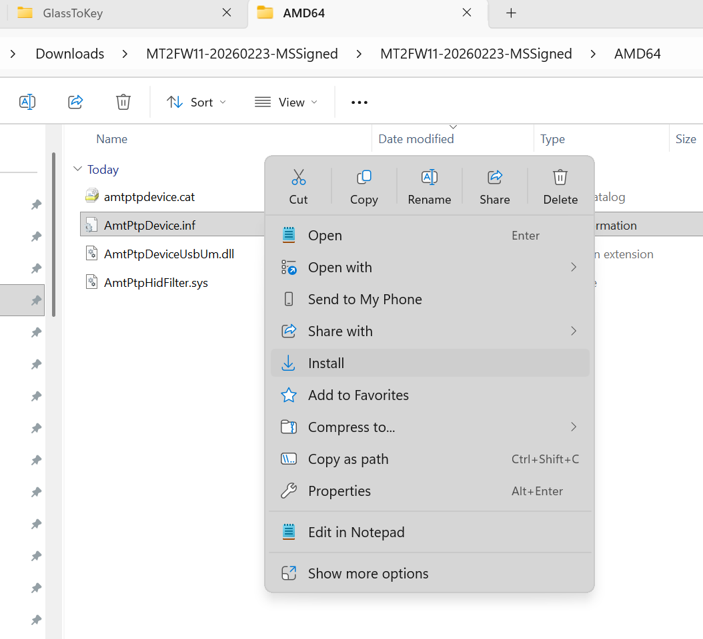
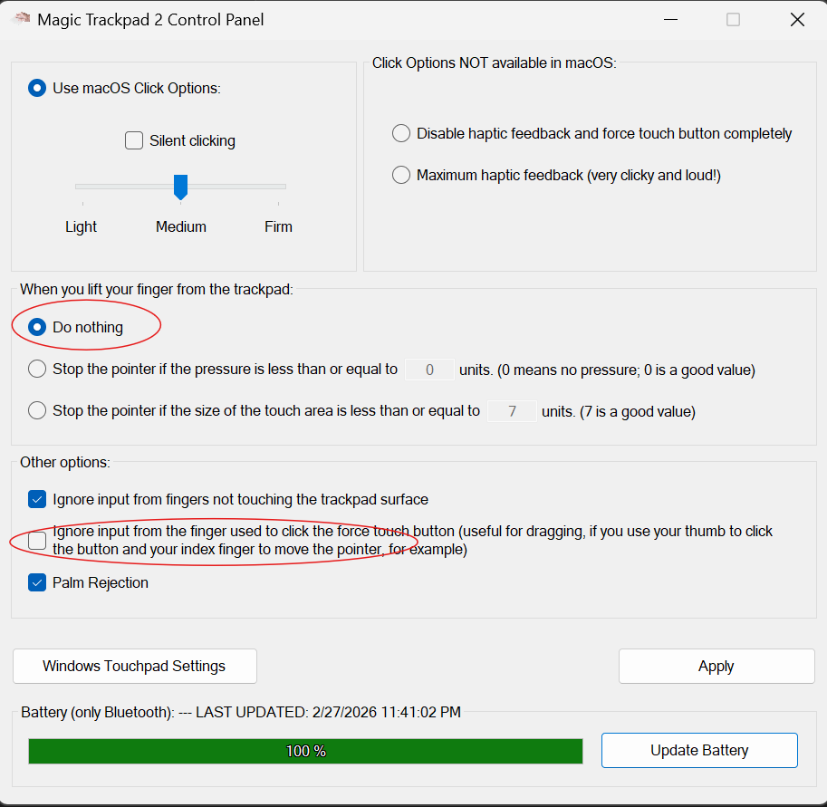

# Driver Install Guide
You may need to install the driver for both USB and for Bluetooth! (For each Apple Magic Trackpad)

## Do you have drivers installed for your trackpad already??
- Go to a webpage and try to 2-finger scroll. If you can move your mouse and you can scroll with a 2-finger gesture — you already have drivers installed! **(You should be able to start AppleMagicTouchstream to see your touches)**
- **If you can move your mouse but you can't scroll with a gesture — perfect!** *You need to install drivers:*

## (⭐️Preferred) Download the Opensource drivers:
- https://github.com/vitoplantamura/MagicTrackpad2ForWindows/releases

Download the .zip file, right-click the `.INF` file and click `Install`

For me, personally, I also need to make these adjustments using the driver's Control Panel:

