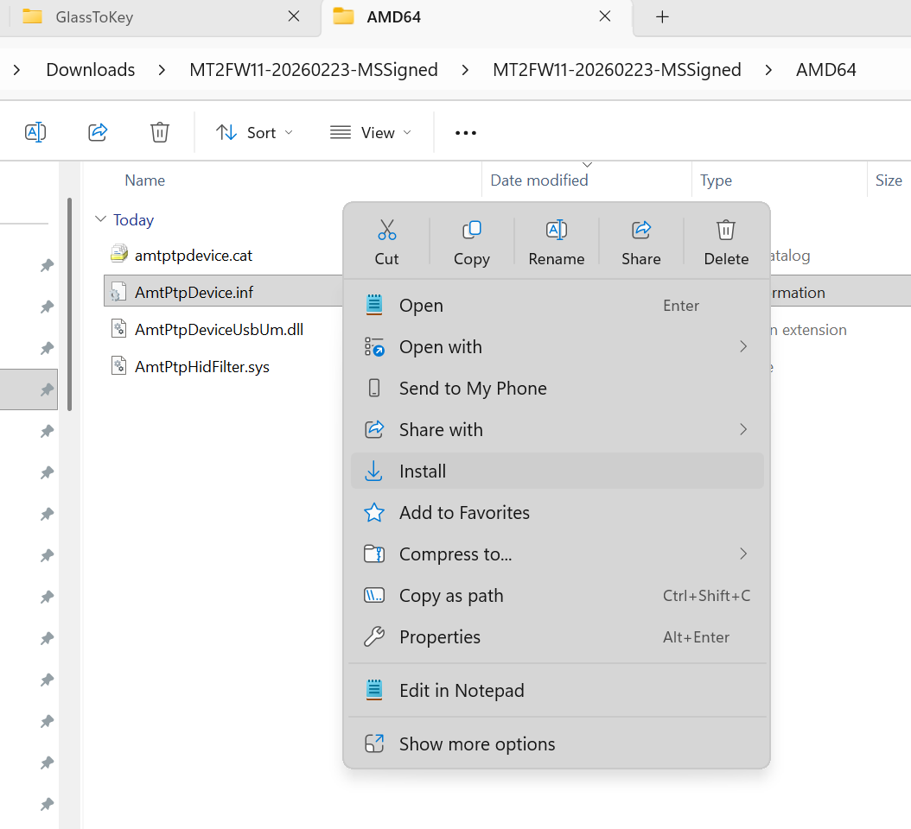
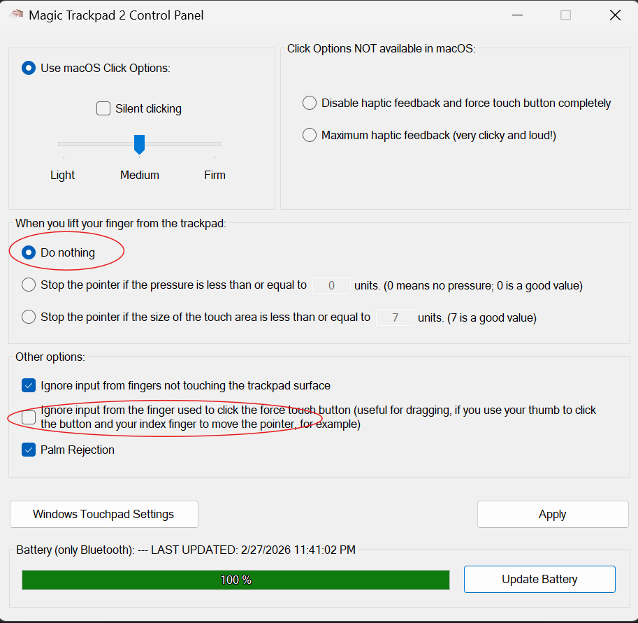

# Driver Install Guide
You may need to install the driver for both USB and for Bluetooth! (For each Apple Magic Trackpad)

## Do you have drivers installed for your trackpad already??
- Go to a webpage and try to 2-finger scroll. If you can move your mouse and you can scroll with a 2-finger gesture — you already have drivers installed! **(You should be able to start GlassToKey and select one of the decoders to see your touches)**
- **If you can move your mouse but you can't scroll with a gesture — perfect!** *You need to install drivers:*

## (⭐️Preferred) Download the Official Apple Bootcamp drivers:
- https://github.com/lc700x/MagicTrackPad2_Windows_Precision_Drivers/releases#release-2.1

**——For USB:——** 
- Right-click the `.INF` files and click `Install`

**——For Bluetooth:——** 
- Right-click the `.INF` files and click `Install`

## (Option2) Download the Opensource drivers:
- https://github.com/vitoplantamura/MagicTrackpad2ForWindows/releases/tag/v2.0
- ***Force Min and Force Max settings will not apply when using the Opensource drivers.**
- **Windows11 only**

Download the .zip file, right-click the `.INF` files and click `Install`

For me, personally, I also need to make these adjustments using the driver's Control Panel:

