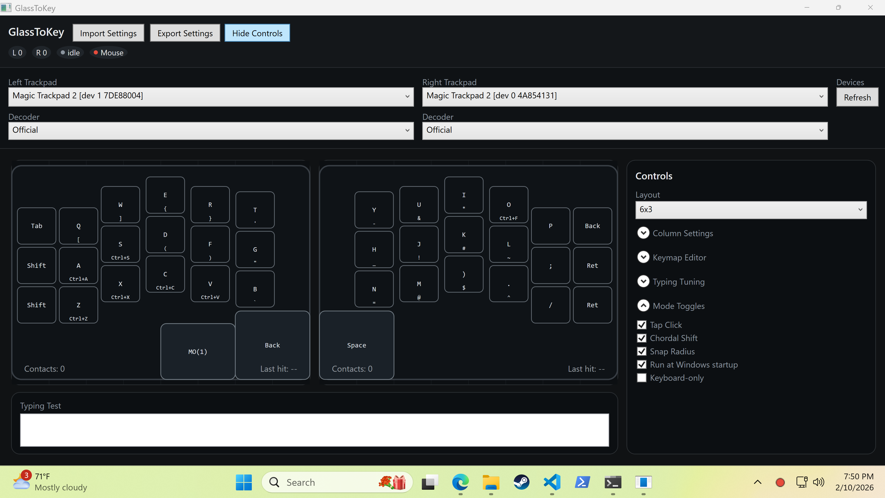

## GlassToKey
GlassToKey for Windows.

## Usage
The tray and application use the Mac hand silhouette in black. Keyboard typing stays available; configured multi-finger gestures reserve their contact cycles. The former Keyboard/Mouse mode and colored mode indicators are removed. Old mode settings and typing-toggle bindings cannot switch Windows into mouse-only or keyboard-only operation. See [Windows input policy](WINDOWS_INPUT_POLICY.md).

Right-clicking the indicator opens `Config...`, `Release Mouse Takeover (Ctrl+Alt+R)`, `Capture`, `Replay`, `Restart`, and `Exit`.

By default, GlassToKey opens the config window on launch. To start tray-only (taskbar icon only), enable `Start in taskbar (tray only)` in `Options`.

### Configuration layout

The left column contains device/decoder selectors, Mouse Takeover, the two trackpad views, and the typing test. The right column has **Keyboard** and **Gestures** tabs, matching the Mac inspector arrangement. Selecting a key or custom button opens its keyboard editor. **Hide Settings** expands the trackpad area; narrow windows can scroll the trackpad workspace. See [layout notes and previews](WINDOWS_UI_LAYOUT.md).

### Mouse Takeover

Below the decoder selectors, enable **Mouse Takeover** for this session or use **30sec test**. It blocks physical movement, clicks, and wheel events from all mice while injected GlassToKey output passes. **Ctrl+Alt+R** releases globally; the checkbox/status and tray indicator update together. It defaults off at startup. Windows shell gestures may need separate settings. See [Mouse Takeover](WINDOWS_MOUSE_TAKEOVER.md).

### Pin Tray Icon
- Windows 11:
  - `Settings` -> `Personalization` -> `Taskbar` -> `Other system tray icons` -> turn on `GlassToKey`.
- Windows 10:
  - `Settings` -> `Personalization` -> `Taskbar` -> `Select which icons appear on the taskbar` -> turn on `GlassToKey`.
- You can also drag the icon from the hidden tray (`^`) to the visible tray area.




## Typing Tuning
- Hold duration (ms): Time in miliseconds until a tap becomes a hold
- Typing Grace (ms): Time after a key dispatch to keep typing intent active.
- Drag cancel (mm): How far you need to move before tap becomes a drag
- Intent Move (mm): Movement threshold before a touch is treated as mouse intent.
- Intent Velocity (mm/s): Speed threshold before a touch is treated as mouse intent.
- Force Instead of Hold is configured per key/custom button. Windows ignores the old global Force Min/Max gates.
- Gestures: grouped per-hand tap/movement, 1–5-finger force click and independent 2–5-finger pinch/spread with Zoom or Windows system actions. See [the latest Mac gesture port](WINDOWS_MAC_GESTURE_PORT.md) for input requirements and live checks. Existing two-finger pointer/tap, three-finger row drag/tap and four-finger scroll/pan with momentum remain available. Movement/tap actions are configurable; pointer/drag use Apple reference acceleration, sensitivity uses sliders, and Natural scrolling switches direction. Output requires Mouse Takeover. See [Windows gesture engine](WINDOWS_GESTURE_ENGINE.md) for defaults, platform differences, and the hardware check.
- Snap Radius: On release during typing intent, off-key taps will snap to the nearest key center if the release point is within this percent of the key’s smaller dimension.

## Intent State Machine
GlassToKey runs a simple intent state machine to decide when touches should be interpreted as typing vs mouse input. The internal diagnostic states use these labels (the old intent/mode badges are no longer displayed): `idle`, `cand`, `typing`, `mouse`, `gest`.

- **Idle (`idle`)**: No active contacts. Any touch that begins on a key enters `keyCandidate`; otherwise it enters `mouseCandidate`.
- **KeyCandidate (`cand`)**: A short buffer window (fixed at 20ms) watches for mouse-like motion. If the touch stays within thresholds, it becomes `typingCommitted`.
- **TypingCommitted (`typing`)**: Key dispatches are allowed. Typing Grace keeps this state alive for a short window after a key is released.
- **MouseCandidate (`mouse`)**: Short buffer window (fixed at 20ms) watching for mouse-like motion. If motion exceeds thresholds or the buffer elapses, it becomes `mouseActive`.
- **MouseActive (`mouse`)**: Typing is suppressed while mouse intent is active.
- **GestureCandidate (`gest`)**: Multi-finger gesture guard. If 2+ touches begin within the 20ms buffer (or 3+ touches arrive together), typing is suppressed and intent displays as gesture until the contact count drops.

Transitions and notes:
- **Typing Grace** extends `typingCommitted` after a key dispatch, even if all fingers lift.
- **Tap/Drag** immediately disqualifies the touch and forces `mouseActive`.
- **GestureCandidate** enters when 2+ touches start within the key buffer window (or 3+ simultaneous touches) and exits back to `idle` once fewer than two contacts remain.


## Build

The Mac gold-standard port now includes TouchStream's independently traced sides/reference background, resizable inspectors, searchable gesture actions, Mirror Edit, separate coordinated Both gestures, 2–5-finger holds, four/five-finger taps and directional movement. See [current parity and hardware testing](MAC_GOLD_PARITY.md) for supported behavior and remaining differences.

```
dotnet build GlassToKey.Windows\GlassToKey.Windows.csproj -c Release
```


### Optional arguments
- `--maxx <value>` / `--maxy <value>`: Force coordinate scaling.
- `--config`: Open config visualizer on startup (live runtime remains tray-hosted).
- `--tray-only`: Internal flag used for restarts that should come back tray-only without reopening Config.
- `--list`: Print available trackpad interfaces.
- `--capture <path>`: Write captured reports to binary `.atpcap` format.
- `--replay <capturePath>`: Replay a capture without opening the UI.
- `--replay-ui`: When used with `--replay`, opens UI playback mode (instead of headless replay).
  - Capture/replay UI sessions launch maximized for full-screen inspection.
- `--relaunch-tray-on-close`: Internal flag used by tray-initiated capture/replay to relaunch normal tray mode when the window closes.
- `--replay-speed <x>`: Initial replay speed multiplier (for example: `0.5`, `1`, `2`).
- `--fixture <fixturePath>`: Optional expected replay fingerprint/counts JSON (also supports intent fingerprint + transition count).
- `--metrics-out <path>`: Write metrics JSON snapshot.
- `--replay-trace-out <path>`: Write detailed replay trace JSON (intent transitions, dispatch events, diagnostics).
  - Dispatch events/diagnostics include `dispatchLabel` (for example `A`, `TypingToggle`, `Ctrl+C`, `ChordShift`) for direct intent debugging.
  - Diagnostics include `ReleaseDropped` reasons (`drag_cancel`, `off_key_no_snap`, `hold_consumed`) when a touch release does not emit a key dispatch.
- `--raw-analyze <capturePath>`: Analyze captured raw HID packets and print report signatures + decode classification, including slot-byte lifecycle stats (`+1/+6/+7/+8`) and button-correlated slot summaries (`+6/+7/+8`, up/down and edge-frame snapshots) for official decoded PTP contacts.
- `--raw-analyze-out <path>`: Write raw analysis JSON output.
- `--raw-analyze-contacts-out <path>`: Write per-contact CSV rows for decoded frames (raw PTP ID/flags/XY alongside assigned decoded ID/flags/XY + slot hex + decoded/raw button/scan/contact-tail fields).
- `--selftest`: Run deterministic local self-tests (parser, replay, intent, dispatch, toggle, chord, five-finger swipe) and exit.

### Self-Tests
- Entry point: `WindowsDiagnostics/SelfTestRunner.cs` (`dotnet run --project GlassToKey.Windows\GlassToKey.Windows.csproj -c Release -- --selftest`).
- Coverage includes parser/decoder checks, button-edge tracking, replay determinism + replay-trace validation, intent-mode transitions, dispatch behavior (snap/drag cancel/modifiers/chords), typing-toggle flows, and five-finger swipe toggle behavior.
- Data source is primarily synthetic and deterministic: tests build `InputFrame` sequences in memory and assert emitted snapshots/events.
- Replay self-tests also generate a temporary synthetic `.atpcap` capture on disk, then replay and validate expected fingerprints/counters.
- Recorded captures are still supported for manual or fixture-based replay via `--capture`, `--replay`, and `--fixture`, but they are not required for the built-in self-test pass.

### Generate Replay Fixture From Capture
1. Capture or choose a replay file (`.atpcap`).
2. Generate fixture JSON:
   - `powershell -ExecutionPolicy Bypass -File GlassToKey.Windows\fixtures\replay\New-ReplayFixture.ps1 -CapturePath GlassToKey.Windows\fixtures\replay\your_capture.atpcap -RelativeCapturePath`
3. Validate replay against the generated fixture:
   - `dotnet run --project GlassToKey.Windows\GlassToKey.Windows.csproj -c Release -- --replay GlassToKey.Windows\fixtures\replay\your_capture.atpcap --fixture GlassToKey.Windows\fixtures\replay\your_capture.fixture.json`

Notes:
- If `-FixturePath` is omitted, the script writes `<capture-name>.fixture.json` next to the capture.
- Use `-ProjectPath` if `GlassToKey.Windows.csproj` is not at the default relative path.


## Files Created at Runtime
- `<app-folder>\\settings.json`: device selections + active layer.
- `%LOCALAPPDATA%\\GlassToKey\\keymap.json`: layered keymap overrides.
- `%LOCALAPPDATA%\\GlassToKey\\runtime-errors.log`: guarded runtime exception log (raw input/device context + stack traces).
- `.atpcap` records embed side hints (`left`/`right`/`unknown`) and decoder profile (`official`/`opensource`) metadata for deterministic replay routing.
- Current capture write format version is `2` (`ATPCAP01` + v2 record headers); replay accepts both v2 and v3 captures.
- For macOS v3 captures, replay applies compatibility normalization (OpenMT Y-axis flip + side-hint swap) before dispatch.
- On first run (no local settings/keymap), defaults are loaded from `GLASSTOKEY_DEFAULT_KEYMAP.json` beside the executable.
